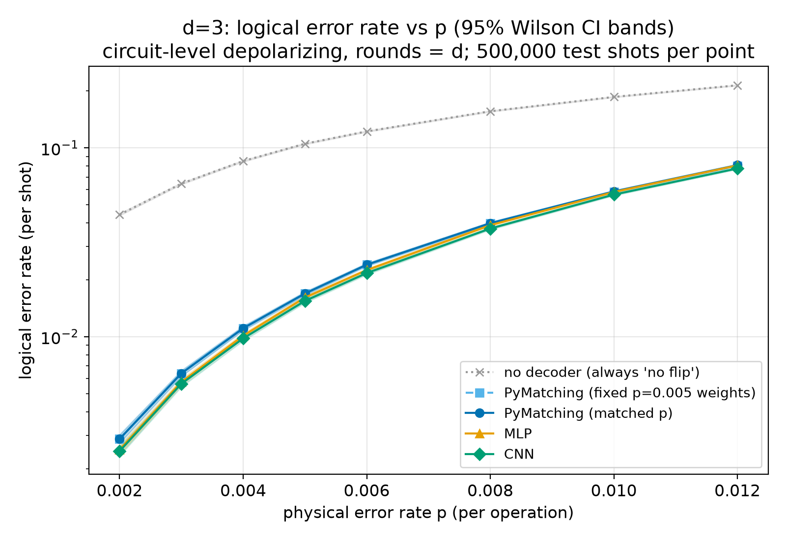
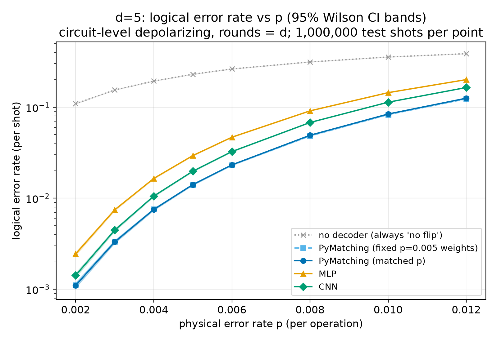
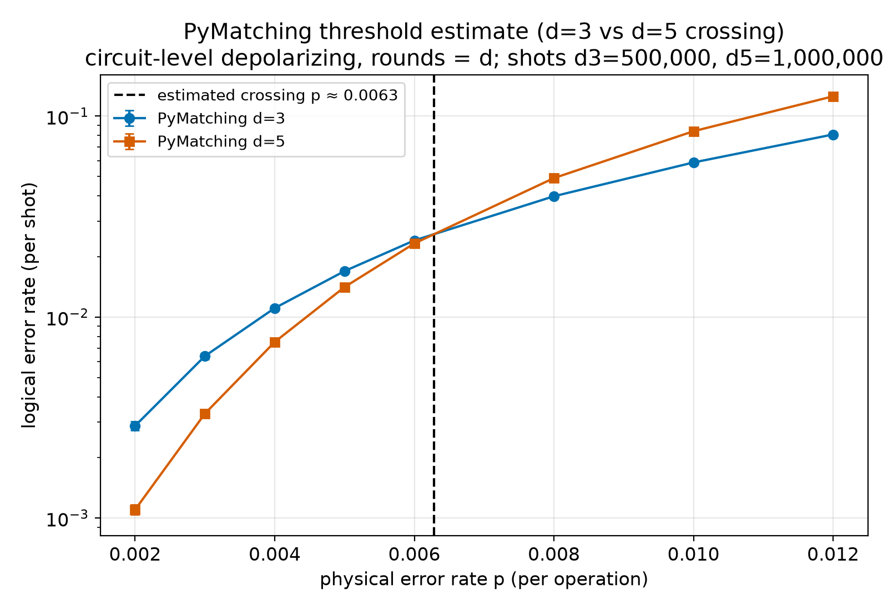
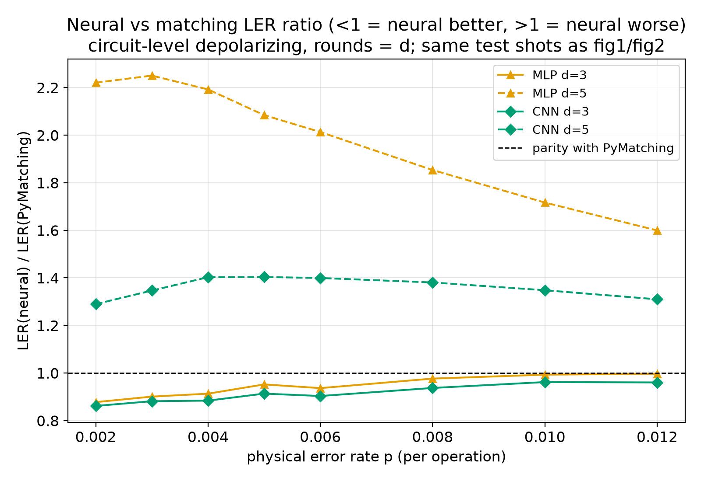
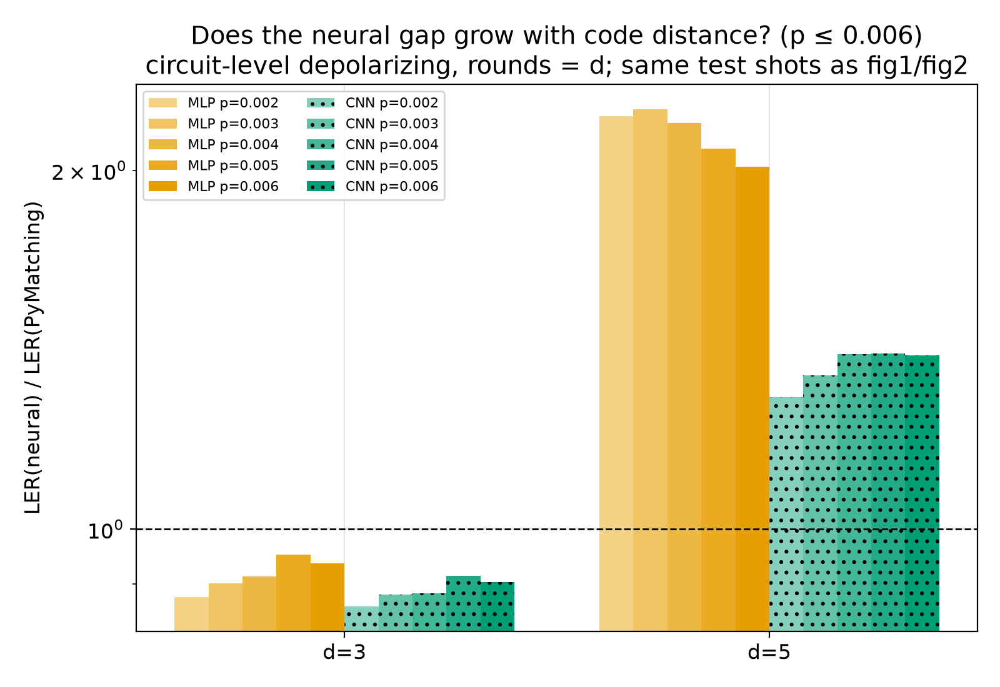
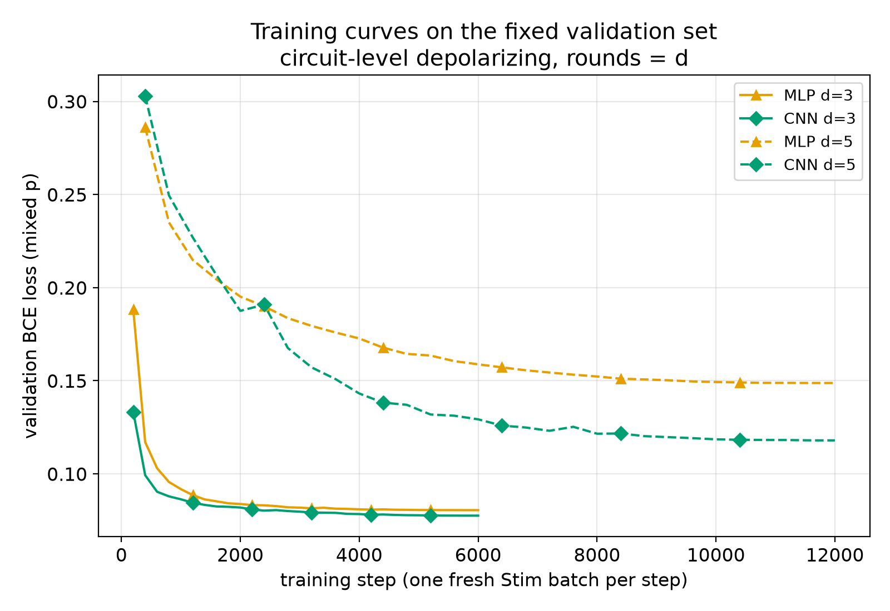
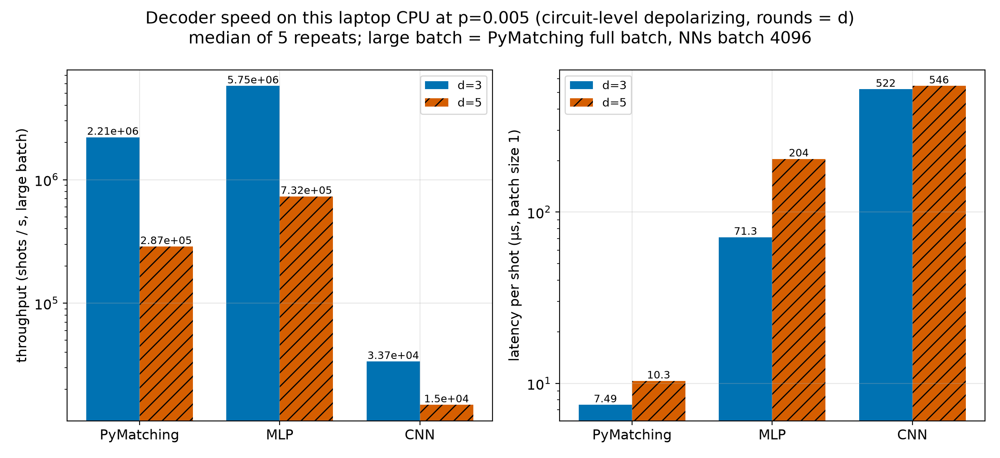
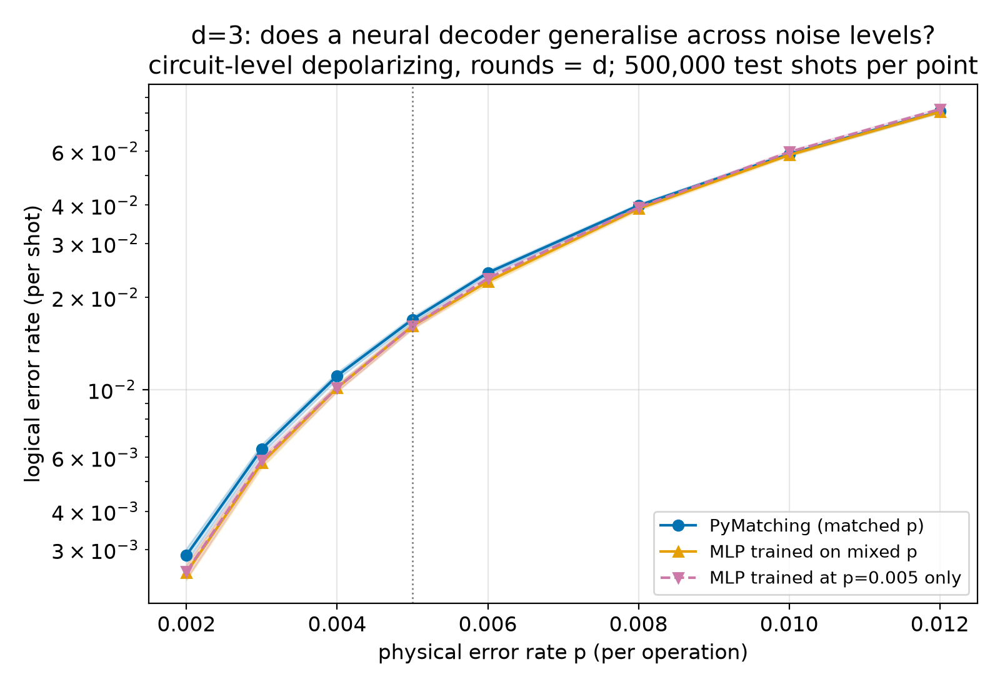
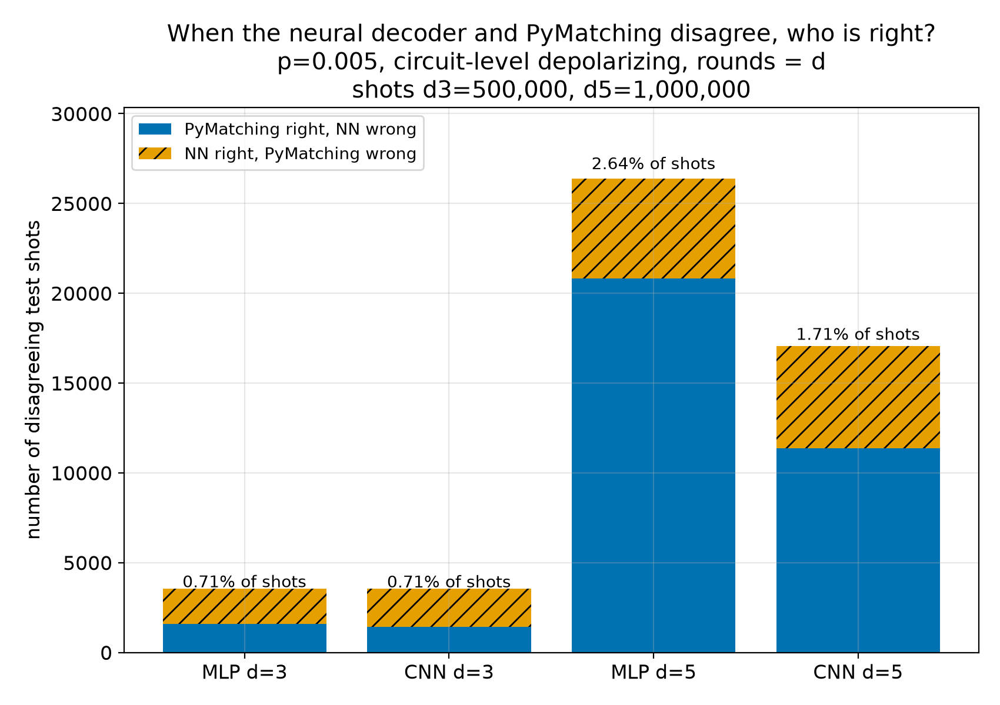

# Surface-Code Decoding: PyMatching vs. Small Neural Decoders

**Course:** Quantum Computing (25AM3504)
**Team:** ____

## 1. Background

A **surface code** stores one logical qubit in a 2D grid of d×d data qubits. Ancilla qubits repeatedly measure
local parity checks (stabilizers) of neighbouring data qubits. A check whose outcome changes between rounds is a
**detection event**; the set of detection events of one experiment is the **syndrome**. Errors create detection
events at their endpoints, but the syndrome does not say which error happened. A **decoder** takes the syndrome and
decides whether the logical qubit was flipped, so the flip can be undone in software. If it guesses wrong, a
**logical error** occurs. Below the **threshold** physical error rate, increasing d suppresses logical errors.

**Minimum-weight perfect matching (MWPM)** turns the syndrome into a graph problem: each possible error mechanism
is an edge weighted by log((1-q)/q) for its probability q, and the decoder pairs up detection events (or connects
them to the boundary) with the lowest total weight. PyMatching implements this efficiently.

**Neural decoders** instead learn the map from syndrome to logical flip from simulated examples. They can in principle
capture correlations that matching ignores (for example Y errors that flip both X and Z checks), but they need training
data, can be slow, and their accuracy has to be checked as the code grows.

**Base paper.** *Rethink the Role of Neural Decoders in Quantum Error Correction* (Ge Yan, Shanchuan Li, Yuxuan Du;
arXiv:2605.12046; listed as accepted to ICML 2026). We read its arXiv abstract and introduction (not the full paper).
In our own words: the authors argue that neural decoders are held back by an accuracy-latency trade-off, often at
microsecond timescales. They reproduce five architecture families (MLP, CNN, TCN, Transformer, GNN) on surface codes up
to d=9, mostly on Stim simulations, and add a pruning and quantization pipeline evaluated on FPGA hardware. Their stated
findings are that training-data scale matters more than architectural complexity in the near term, that a suitable
inductive bias is essential for accuracy, that generic MLPs fail to scale, and that INT4 quantization (via
quantization-aware training) is needed for microsecond latency. Our project is a much smaller, CPU-only version of the
first question: how close do a small MLP and a small CNN get to PyMatching at d=3 and d=5?

## 2. Method

- **Circuit.** `stim.Circuit.generated("surface_code:rotated_memory_z")`, distances [3, 5], rounds = d.
  Circuit-level depolarizing noise, rounds = d: after every Clifford gate, after every reset, before every measurement and on every data qubit
  at the start of each round, an error with probability p. d=3 has 24 detectors and d=5 has 120.
- **Noise sweep.** p = 0.002, 0.003, 0.004, 0.005, 0.006, 0.008, 0.01, 0.012.
- **Data.** Training batches are sampled fresh from Stim at every step (no fixed training set); each batch is
  8 sub-batches, each with p drawn uniformly from the sweep. Validation (used only for checkpoint
  selection) and test (used only for the numbers below) sets are fixed and use different seeds
  (train 1000, val 2000, test 3000, per-(d, p) offsets).
  Test shots per (d, p): d=3 500,000, d=5 1,000,000.
- **PyMatching.** Matching graph built from `circuit.detector_error_model(decompose_errors=True)` separately for every
  (d, p), so the weights match the true noise. A second variant uses the graph for p=0.005 at every p.
- **MLP.** Fully connected ReLU network on the flat detector vector (d=3: 24→128→64→1; d=5: 120→256→128→64→1).
- **CNN.** Detectors are placed on a [T, H, W] grid by rank-encoding their Stim (x, y, t) coordinates; time is used as
  the channel axis. Three 3×3 conv layers (32, 64, 64 channels) and a 128-unit dense head. No changes to this
  architecture were needed.
- **Training.** Binary cross-entropy on the logical-flip label, Adam, cosine learning-rate decay, gradient clipping at
  1.0; the checkpoint with the lowest validation loss is kept.

| model | params | steps | best val step | batch | lr | train time (s) |
|---|---|---|---|---|---|---|
| mlp_d3 | 11,521 | 6,000 | 6,000 | 4096 | 0.001 | 67.1 |
| cnn_d3 | 187,937 | 6,000 | 6,000 | 4096 | 0.001 | 2,112.4 |
| mlp_d5 | 72,193 | 12,000 | 12,000 | 4096 | 0.001 | 375.6 |
| cnn_d5 | 352,353 | 12,000 | 12,000 | 4096 | 0.001 | 9,350.3 |
| mlp_fixedp_d3 | 11,521 | 6,000 | 6,000 | 4096 | 0.001 | 55.0 |

- **Statistics.** Logical error rate = errors / shots, with a 95% Wilson score interval
  (centre = (k/n + z²/2n) / (1 + z²/n), half-width = z·sqrt(k/n·(1-k/n)/n + z²/4n²) / (1 + z²/n), z = 1.96), which stays
  inside [0, 1] and is sensible at 0 errors. "Tied" below means the two 95% intervals overlap, i.e. not statistically
  distinguishable.

## 3. Results

### 3.1 Logical error rate vs physical error rate

LER per shot with 95% Wilson CI at selected p (full sweep in `results/ler_results.csv`):

| d | p | No decoder | PyMatching | PyMatching (fixed p=0.005 weights) | MLP | CNN |
|---|---|---|---|---|---|---|
| 3 | 0.003 | 0.0646 [0.0639, 0.0653] | 0.0064 [0.0062, 0.0066] | 0.0064 [0.0062, 0.0066] | 0.0058 [0.0056, 0.0060] | 0.0056 [0.0054, 0.0058] |
| 3 | 0.005 | 0.1050 [0.1042, 0.1059] | 0.0169 [0.0166, 0.0173] | 0.0169 [0.0166, 0.0173] | 0.0161 [0.0158, 0.0165] | 0.0155 [0.0151, 0.0158] |
| 3 | 0.008 | 0.1561 [0.1551, 0.1571] | 0.0399 [0.0394, 0.0404] | 0.0398 [0.0393, 0.0404] | 0.0390 [0.0384, 0.0395] | 0.0374 [0.0369, 0.0379] |
| 5 | 0.003 | 0.1543 [0.1536, 0.1551] | 0.0033 [0.0032, 0.0034] | 0.0033 [0.0032, 0.0034] | 0.0074 [0.0073, 0.0076] | 0.0045 [0.0043, 0.0046] |
| 5 | 0.005 | 0.2296 [0.2288, 0.2304] | 0.0141 [0.0139, 0.0143] | 0.0141 [0.0139, 0.0143] | 0.0294 [0.0290, 0.0297] | 0.0198 [0.0195, 0.0201] |
| 5 | 0.008 | 0.3136 [0.3127, 0.3145] | 0.0491 [0.0487, 0.0495] | 0.0483 [0.0479, 0.0487] | 0.0910 [0.0905, 0.0916] | 0.0678 [0.0673, 0.0683] |

### 3.2 Threshold

The PyMatching d=3 and d=5 curves cross at p ≈ 0.0063 (between the sweep points 0.006 and 0.008, linear interpolation of the log-LER difference). Below this value the larger code is better; above it the larger code is worse.

### 3.3 Neural vs matching ratio and scaling with distance

### 3.4 Training curves

### 3.5 Speed and size

Hardware: Intel(R) Core(TM) i5-10210U CPU @ 1.60GHz; 8 logical CPUs; torch threads 8; CPU only.

| decoder | d | batch size | µs per shot | shots per second |
|---|---|---|---|---|
| PyMatching | 3 | 100,000 | 0.45 | 2,207,157 |
| PyMatching | 3 | 1 | 7.49 | 133,524 |
| MLP | 3 | 4,096 | 0.17 | 5,751,519 |
| MLP | 3 | 1 | 71.30 | 14,026 |
| CNN | 3 | 4,096 | 29.71 | 33,662 |
| CNN | 3 | 1 | 521.81 | 1,916 |
| PyMatching | 5 | 100,000 | 3.48 | 287,268 |
| PyMatching | 5 | 1 | 10.32 | 96,884 |
| MLP | 5 | 4,096 | 1.37 | 732,174 |
| MLP | 5 | 1 | 204.41 | 4,892 |
| CNN | 5 | 4,096 | 66.71 | 14,989 |
| CNN | 5 | 1 | 545.54 | 1,833 |

### 3.6 Generalisation across noise levels (d=3)

| p | PyMatching | MLP (mixed p) | MLP (p=0.005 only) | fixed / mixed |
|---|---|---|---|---|
| 0.002 | 0.0029 [0.0027, 0.0030] | 0.0025 [0.0024, 0.0027] | 0.0025 [0.0024, 0.0027] | 1.01 |
| 0.003 | 0.0064 [0.0062, 0.0066] | 0.0058 [0.0056, 0.0060] | 0.0059 [0.0057, 0.0061] | 1.02 |
| 0.004 | 0.0111 [0.0108, 0.0114] | 0.0101 [0.0098, 0.0104] | 0.0101 [0.0098, 0.0104] | 1.00 |
| 0.005 | 0.0169 [0.0166, 0.0173] | 0.0161 [0.0158, 0.0165] | 0.0161 [0.0158, 0.0165] | 1.00 |
| 0.006 | 0.0240 [0.0236, 0.0245] | 0.0225 [0.0221, 0.0229] | 0.0230 [0.0226, 0.0235] | 1.02 |
| 0.008 | 0.0399 [0.0394, 0.0404] | 0.0390 [0.0384, 0.0395] | 0.0394 [0.0388, 0.0399] | 1.01 |
| 0.01 | 0.0588 [0.0581, 0.0594] | 0.0583 [0.0577, 0.0590] | 0.0597 [0.0590, 0.0603] | 1.02 |
| 0.012 | 0.0809 [0.0802, 0.0817] | 0.0807 [0.0799, 0.0814] | 0.0823 [0.0816, 0.0831] | 1.02 |

### 3.7 Disagreements at p=0.005

| decoder | d | disagree with PyMatching | NN right | PyMatching right | both wrong (agree) |
|---|---|---|---|---|---|
| MLP | 3 | 3,559 (0.71%) | 1,982 | 1,577 | 6,480 |
| CNN | 3 | 3,551 (0.71%) | 2,142 | 1,409 | 6,320 |
| MLP | 5 | 26,382 (2.64%) | 5,550 | 20,832 | 8,543 |
| CNN | 5 | 17,067 (1.71%) | 5,689 | 11,378 | 8,404 |

## 4. Analysis

**Do the neural decoders match PyMatching at d=3?** Over the 8 noise levels, the MLP is significantly better than PyMatching at p = 0.002, 0.003, 0.004, 0.005, 0.006, statistically tied with it (overlapping 95% CIs) at p = 0.008, 0.01, 0.012; its LER ratio to PyMatching ranges from 0.88 to 1.00, largest at p = 0.012; the CNN is significantly better than PyMatching at p = 0.002, 0.003, 0.004, 0.005, 0.006, 0.008, 0.01, 0.012; its LER ratio to PyMatching ranges from 0.86 to 0.96, largest at p = 0.01.

**Do the neural decoders match PyMatching at d=5?** Over the 8 noise levels, the MLP is significantly worse at p = 0.002, 0.003, 0.004, 0.005, 0.006, 0.008, 0.01, 0.012; its LER ratio to PyMatching ranges from 1.60 to 2.25, largest at p = 0.003; the CNN is significantly worse at p = 0.002, 0.003, 0.004, 0.005, 0.006, 0.008, 0.01, 0.012; its LER ratio to PyMatching ranges from 1.29 to 1.40, largest at p = 0.005.

**Does the gap grow with distance?** Averaged over the sweep, the LER ratio to PyMatching is MLP 0.94 at d=3 vs 1.99 at d=5; CNN 0.91 at d=3 vs 1.36 at d=5 (see fig4 and fig9). For both networks the ratio grows with d, i.e. they capture less of the extra protection a bigger code provides.

**Error suppression from d=3 to d=5 at p=0.002.** PyMatching's LER drops by a factor of 2.6; the MLP's drops by a factor of 1.0; the CNN's drops by a factor of 1.7.

**Sensitivity of PyMatching to its noise model.** Using edge weights computed for p=0.005 instead of the true p changes the d=5 LER by a factor of 1.006 at p=0.002 and 0.983 at p=0.012 (1.00 = no change).

**Noise-model mismatch for neural decoders (d=3).** The MLP trained only at p=0.005 has 1.00x the LER of the mixed-p MLP at its own training noise, 1.01x at p=0.002 and 1.02x at p=0.012. At this small distance the single-p network transfers about as well as the mixed-p one (all ratios within 10% of 1), so we see no strong brittleness here; this may not hold at larger d. PyMatching needs no retraining: it is rebuilt from the detector error model for each p.

**Speed and size.** At d=5, p=0.005 on this CPU, PyMatching decodes 287,268 shots/s in a large batch and takes 10.3 µs per single shot; MLP 732,174 shots/s at batch 4096 and 204.4 µs at batch 1; CNN 14,989 shots/s at batch 4096 and 545.5 µs at batch 1. The neural models have MLP d=3: 11,521, CNN d=3: 187,937, MLP d=5: 72,193, CNN d=5: 352,353 parameters. In relative terms, in large batches the MLP is 2.55x PyMatching's throughput, and at batch 1 its latency is 19.8x PyMatching's; in large batches the CNN is 0.05x PyMatching's throughput, and at batch 1 its latency is 52.9x PyMatching's. Python-level per-call overhead dominates the batch-1 numbers for the networks; real-time decoding would need compiled or hardware (FPGA/ASIC) inference.

**Disagreements at p=0.005.** MLP d=3: 0.71% of shots, NN right in 1,982 vs PyMatching right in 1,577; CNN d=3: 0.71% of shots, NN right in 2,142 vs PyMatching right in 1,409; MLP d=5: 2.64% of shots, NN right in 5,550 vs PyMatching right in 20,832; CNN d=5: 1.71% of shots, NN right in 5,689 vs PyMatching right in 11,378. The networks win a share of the disagreements in at least one setting, so they capture some structure that matching does not.

**Summary.**
- d=3, p=0.005: PyMatching LER 0.0169; MLP 0.0161 (0.95x matching, better); CNN 0.0155 (0.91x matching, better).
- d=5, p=0.005: PyMatching LER 0.0141; MLP 0.0294 (2.08x matching, worse); CNN 0.0198 (1.40x matching, worse).
- Speed at d=5 on this CPU: PyMatching 287,268 shots/s vs fastest neural net (MLP, batch 4096) 732,174 shots/s; single-shot latency PyMatching 10.3 µs vs MLP 204.4 µs.

## 5. Limitations

- Only the Z-basis memory experiment (storing a qubit, no logical gates), one noise model (uniform circuit-level
  depolarizing), and only d=3 and d=5.
- Each shot is decoded as a whole block of d rounds; there is no sliding-window or streaming decoding.
- The neural networks are deliberately small and trained for a fixed budget on a laptop CPU; larger models and more
  data (the base paper's main lever) could narrow the gap.
- Timings are CPU-only, in Python, on one laptop; they are not representative of an optimised real-time decoder.
- Finite statistics: at the lowest p the d=5 LER is estimated from relatively few errors, so CIs are wide there.

## 6. Future work

- Larger distances (d=7, 9) and more rounds, to test whether the neural gap keeps growing.
- Architectures with a better inductive bias for the lattice: graph neural networks or transformers on the detector graph.
- Correlated or biased noise, where matching's independence assumption is wrong and learning can help most.
- Hybrid decoders: matching first, then a network that predicts when to override it.
- Real-time constraints: quantization and FPGA deployment, as studied in the base paper.

## 7. Reproducibility

- `python run_all.py --full` regenerates everything (`--quick` for a smoke test); `python demo.py --d 3 --p 0.01`.
- Seeds: train 1000, val 2000, test 3000, demo 4000 (per-(d, p) offsets added, see `config.split_seed`). Results above come from the `--full` run.
- Hardware: Intel(R) Core(TM) i5-10210U CPU @ 1.60GHz; 8 logical CPUs; torch threads 8; CPU only.
- Package versions: see `results/env.txt` and `requirements.txt`.

## 8. References

1. Ge Yan, Shanchuan Li, Yuxuan Du. *Rethink the Role of Neural Decoders in Quantum Error Correction.* arXiv:2605.12046.
2. Craig Gidney. *Stim: a fast stabilizer circuit simulator.*
3. Oscar Higgott, Craig Gidney. *Sparse Blossom: correcting a million errors per core second with minimum-weight matching.* (PyMatching v2)
4. Oscar Higgott. *PyMatching: A Python package for decoding quantum codes with minimum-weight perfect matching.*
5. Austin G. Fowler, Matteo Mariantoni, John M. Martinis, Andrew N. Cleland. *Surface codes: Towards practical large-scale quantum computation.*
